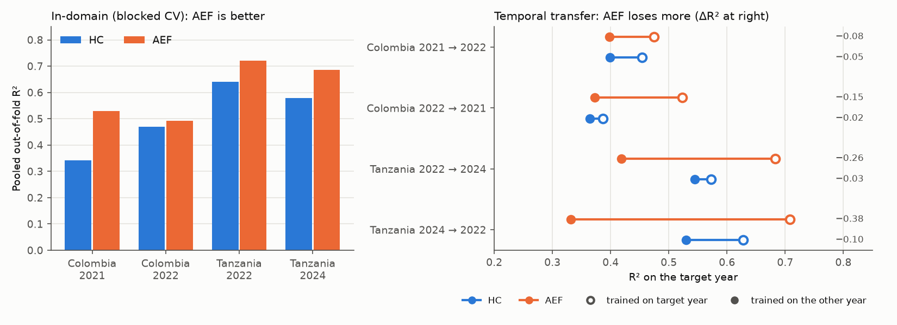
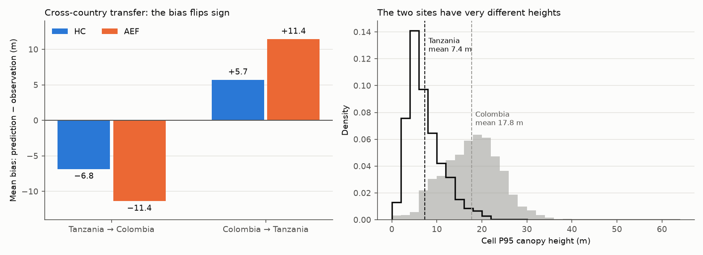

# Canopy height transfer with AlphaEarth embeddings

Predict canopy height (P95 of a lidar canopy height model, per 100 m cell) from satellite features, and test
how well the models **transfer geographically** (Tanzania ↔ Colombia) and **temporally** (year A → year B).

The question is whether AlphaEarth Foundations (AEF) embeddings transfer better than handcrafted
Sentinel-1/2 features (HC). HC is the baseline in every experiment below.

| | |
|---|---|
| Target | P95 of the lidar CHM (0.5 m) per 100 m cell; cells with < 50 % valid pixels are dropped |
| Sites | Colombia (2021, 2022), Tanzania (2022, 2024) |
| AEF | Google/DeepMind AlphaEarth Foundations Satellite Embedding v1, annual, 64 dims, 10 m |
| HC | 98 handcrafted features: Sentinel-2 medians/indices, Sentinel-1 backscatter statistics, 24 GLCM texture features |
| Model | XGBoost, fixed hyper-parameters, no tuning (200 trees, depth 6, lr 0.1) |
| Validation | 5-fold CV on 1 km spatial blocks, with a 100 m buffer between training and test cells |

Tessera embeddings and a TabICL learner are also implemented (`TES`, `HC+TES`, `model.learner: tabicl`) but are
not the focus here. All numbers are XGBoost, pooled out-of-fold R² unless stated.

## What we found

1. **In-domain, AEF beats HC.** With blocked CV inside one site-year, AEF has the higher R² in all four cases
   (by +0.02 to +0.19).
2. **That advantage does not survive a change of year.** Trained on one year and tested on another, AEF loses
   0.08–0.38 R², HC only 0.02–0.10. In absolute cross-year R², AEF is level with HC in Colombia and well behind
   it in Tanzania.
3. **Neither feature set transfers between countries, in either direction.** Tanzania → Colombia is dominated by
   a large underestimate (Colombia is much taller than anything in the Tanzanian training data). Colombia →
   Tanzania is dominated by a large overestimate. AEF is worse than HC both ways.
4. **A few local blocks beat the transferred model, but only partly close the gap.** With 5 blocks from the target
   site, R² is 0.23 (HC) and 0.26 (AEF) against 0.47 and 0.49 in-domain, and the other country's data adds little
   beyond 2 blocks.

Taken together: in these experiments the embedding's in-domain gain is mostly site- and year-specific. AEF models
may need recalibrating for each new year and site, while HC degrades more gently. One reading of the +11.4 m
AEF bias in Colombia → Tanzania, whose mean prediction is close to Colombia's own mean height, is that AEF encodes
site identity rather than height. That is a hypothesis, not something these experiments test.

## Evidence

### In-domain versus temporal transfer



Left: E1, in-domain blocked CV. Right: E4, cross-year transfer. Each pair of dots is one feature set. The hollow
dot is a model trained and tested on the target year, and the filled dot is a model trained on the other year and
tested on the same cells. The number at the right is the R² lost. Colombia uses the "matched" variant, where both
models train and test on identical cells.

| site-year | HC | AEF | AEF − HC |
|---|---|---|---|
| Colombia 2021 | 0.34 | 0.53 | +0.19 |
| Colombia 2022 | 0.47 | 0.49 | +0.02 |
| Tanzania 2022 | 0.64 | 0.72 | +0.08 |
| Tanzania 2024 | 0.58 | 0.69 | +0.11 |

| direction | HC | HC loss | AEF | AEF loss |
|---|---|---|---|---|
| Colombia 2021 → 2022 | 0.454 → 0.399 | 0.055 | 0.474 → 0.398 | 0.076 |
| Colombia 2022 → 2021 | 0.387 → 0.365 | 0.022 | 0.523 → 0.373 | 0.150 |
| Tanzania 2022 → 2024 | 0.573 → 0.544 | 0.029 | 0.683 → 0.418 | 0.264 |
| Tanzania 2024 → 2022 | 0.628 → 0.529 | 0.098 | 0.708 → 0.332 | 0.376 |

### Geographic transfer



Left: mean bias of the cross-country models. Right: the height distributions of the two sites (all lidar cells).

| | direction | in-domain R² | transfer R² | RMSE (m) | bias (m) |
|---|---|---|---|---|---|
| HC | Tanzania → Colombia (E2) | 0.47 | −0.92 | 8.98 | −6.8 |
| AEF | Tanzania → Colombia (E2) | 0.49 | −2.98 | 12.94 | −11.4 |
| HC | Colombia → Tanzania (E2rev) | 0.64 | −2.33 | 7.23 | +5.7 |
| AEF | Colombia → Tanzania (E2rev) | 0.72 | −8.32 | 12.10 | +11.4 |

Tanzania 2022 heights have a mean of 7.4 m and a 95th percentile of 15.2 m, while Colombia 2022 has a mean of
17.8 m, and 66 % of Colombian cells are above the Tanzanian P95. Tree ensembles can't predict above the range
they were trained on, which explains the large negative bias going Tanzania → Colombia. In the reverse direction
Tanzanian heights are inside the Colombian range, so the failure is a different one: a large overestimate. R² is
not comparable between the two directions because Tanzania's height variance is much smaller. Compare RMSE and bias.

### Few-shot recovery in Colombia 2022 (E3)

R² when k Colombia blocks are used. `tz+k` is Tanzania 2022 plus k Colombia blocks, `k-only` the k Colombia blocks alone.

| k | HC tz+k | HC k-only | AEF tz+k | AEF k-only |
|---|---|---|---|---|
| 1 | −0.01 | −0.04 | −0.04 | −0.34 |
| 2 | 0.19 | −0.01 | 0.18 | −0.15 |
| 5 | 0.23 | 0.21 | 0.26 | 0.21 |
| 10 | 0.30 | 0.31 | 0.34 | 0.32 |
| 20 | 0.36 | 0.37 | 0.38 | 0.38 |

Tanzania data mainly helps at k ≤ 2. From k = 5 on, local data alone does about as well. In-domain R² (E1, repeat 0)
is 0.47 for HC and 0.49 for AEF. Three draws per k, repeat 0 only.

### Year-to-year embedding shift on height-stable cells

Where canopy height did not change (|Δh| ≤ 1 m between the two lidar years), any change in the AEF embedding is
nuisance (season, weather, composite differences). `scripts/stable_shift.py` measures it and
`scripts/e4_shift_correction.py` tests corrections inside the E4 setup (AEF, same folds, buffer and seeds).

**Shift on stable cells (cell means, 100 m)**

| | Tanzania 2022→2024 | Colombia 2021→2022 |
|---|---|---|
| Stable / paired cells | 1,543 / 2,136 | 1,615 / 2,198 |
| Shift energy vs within-year embedding variance | 0.086 vs 0.059 | 0.046 vs 0.190 |
| Share of the shift that is one constant vector | 80 % | 50 % |
| Block-CV R² of the centred shift from the starting embedding | 0.28 | 0.47 |

In Tanzania the shift is larger than the whole spatial variation of the embeddings and is mostly a single translation.
In Colombia it is smaller and depends more on where a cell sits in embedding space. Across cells the shift points the
same way everywhere (Tanzania cosine with the mean shift ≥ 0.81 for 95 % of cells), so there is no separate population of
non-shifting cells. Across dimensions it is concentrated: in Tanzania 8 of 64 dimensions hold 50 % of the squared mean
shift and 20 hold 80 %.

**E4 with corrections** (pooled out-of-fold R², AEF). The mean shift is estimated on training-block cells of both years
only; it is subtracted from the test-year `aef_*_mean` columns. `offset` uses stable cells, `offset_all` all paired cells
(no heights). `drop-k` removes the k most-shifting dimensions from training and test.

| | baseline | offset | offset_all | drop-k (best of 8/20/32) | in-year ceiling |
|---|---|---|---|---|
| Tanzania 2022 → 2024 | 0.418 | 0.638 | 0.635 | 0.593 | 0.683 |
| Tanzania 2024 → 2022 | 0.332 | 0.692 | 0.693 | 0.626 | 0.708 |
| Colombia 2021 → 2022 | 0.298 | 0.357 | 0.358 | 0.334 | 0.488 |
| Colombia 2022 → 2021 | 0.334 | 0.475 | 0.476 | 0.445 | 0.498 |

The offset recovers most of the temporal loss in Tanzania and in Colombia 2022 → 2021, but only about a third of it in
Colombia 2021 → 2022. Dropping dimensions does worse than the offset and costs in-year R² (up to 0.04); combining both
adds nothing over the offset. The label-free offset matches the stable-cell offset to within 0.003 R².

Caveats for this section:
- The offset still uses the target year's embeddings on the training blocks. `offset` also uses target-year heights there.
- Averaging over all paired cells would absorb any real site-wide height change. Mean Δh is small at both sites
  (Tanzania −0.18 m), which is why `offset_all` matches `offset` here. This is not a guarantee elsewhere, and the
  offset is unsuitable for estimating trends; use stable anchors for that.
- Scores are R² against observed height only. Whether predicted change matches observed change per cell is not tested.
- One partition and seed, two sites; k = 8/20/32 and the 1 m stable threshold were fixed in advance, not tuned.
- The Colombia baselines here use all cells of the test year (`full`/`main` E4 variants), not the `matched` cells of the
  table above, so they are not directly comparable to it.

## Caveats

- **Cells.** `pipeline.cells: covered` keeps only cells with Tessera data, identically for every feature set. About 18–21 %
  of Colombia cells are dropped, so the Colombia numbers describe the less cloudy part of the site. Set `cells: all` to
  use every cell. Earlier all-cell results (HC, AEF, HC+AEF, no feature selection) are in
  `results/archive_xgb_allcells_noselect/`.
- **Noise.** One repeat only, and Colombia 2021 is small (1,745 cells, 37 blocks). E3 uses a single partition.
- **Two sites.** The geographic result is one pair of sites, so it says little about transfer in general.
- **Temporal gap.** It differs between sites (1 year in Colombia, 2 in Tanzania), and real canopy change, lidar
  acquisition differences and image-composite differences are all mixed into the temporal loss.
- **No tuning.** One fixed XGBoost configuration is used for every feature set, so rankings could change with tuning.
- **Spatial autocorrelation.** Beyond the 100 m buffer it can make in-domain scores somewhat optimistic.
- **Inference maps.** The in-sample R² in `results/xgboost/maps/maps_meta.csv` is a sanity check only, not an accuracy
  estimate.

## AEF features

AEF is read from the Source Cooperative mirror (`tge-labs/aef/v1/annual`) and de-quantised with
`((v / 127.5)² · sign(v))`, with NaN where the source is −128 (`src/hgt/download_aef.py`).

Each 100 m cell gets 128 AEF features (`src/hgt/features.py`):
- `aef_Axx_mean`: the mean of the 64-d embedding over the cell's valid 10 m pixels, re-normalised to unit length
- `aef_Axx_std`: the per-dimension standard deviation over the same pixels

Feature selection happens inside each training fold. A selector XGBoost is fitted, and features whose mean |SHAP|
is above the average are kept. That is roughly 25–30 of the 128 AEF features.

## Repository layout

```
config.yaml            sites, grids, years, model and pipeline settings (single source of truth)
docs/CONTRACTS.md      file formats and geometry shared by all stages
docs/figures/          README figures (made by scripts/readme_figures.py)
src/hgt/
  download_aef.py      AlphaEarth annual embeddings -> data/raw/aef/
  download_pc.py       Sentinel-1/2 from Planetary Computer -> data/raw/{s1,s2}/
  download_tessera.py  Tessera v1.1 embeddings -> data/raw/tessera/
  targets.py           lidar CHM -> P95 height per 100 m cell
  features.py          per-cell feature tables (HC, AEF, TES), --maps for all grid cells
  splits.py            1 km block splits, buffer, few-shot blocks
  experiments.py       E1-E4 and E2rev
  report.py            figures and summary.md
  inference.py         wall-to-wall 100 m height maps
scripts/               readme_figures.py, check_splits.py, compare_learners.py, pilot_tabicl.py
results/xgboost/       summary.md, metrics.csv, figures/, maps/ (the results above)
results/archive_*/     earlier runs, each with a README
tests/                 pytest suite, run in CI (.github/workflows/tests.yml)
```

## Running it

The lidar CHMs (`data/Colombia/`, `data/Tanzania/`) and all downloaded data are gitignored and not in the repo.
Python 3.12 with [uv](https://docs.astral.sh/uv/):

```bash
uv sync                                         # includes the TabICL/PyTorch group; use --no-group fm to skip it
uv run python -m hgt.download_aef               # all site-years; --site S --year Y [--overwrite] for one
uv run python -m hgt.download_pc                # HC inputs
uv run python -m hgt.download_tessera           # only needed for the TES feature sets
uv run python -m hgt.targets
uv run python -m hgt.features
uv run python -m hgt.experiments --exp all --fs HC AEF   # or E1 | E2 | E3 | E4 | E4matched; --quick for a smoke test
uv run python -m hgt.experiments --exp E2rev --fs HC AEF # reverse E2; not in `all`, and not yet in report.py / summary.md
uv run python -m hgt.report
uv run python scripts/readme_figures.py         # the README figures, from metrics.csv and data/tables
uv run python -m hgt.features --maps && uv run python -m hgt.inference --fs HC AEF
uv run pytest -q
```

Outputs go to `results/{model.learner}/`: `summary.md`, `metrics.csv` (long format), figures, and the maps.

## Data and attribution

The AlphaEarth Foundations Satellite Embedding dataset is produced by Google and Google DeepMind (CC-BY-4.0).
Tessera (Feng et al. 2025, arXiv:2506.20380) is CC-BY-SA, from the AWS Registry of Open Data.
